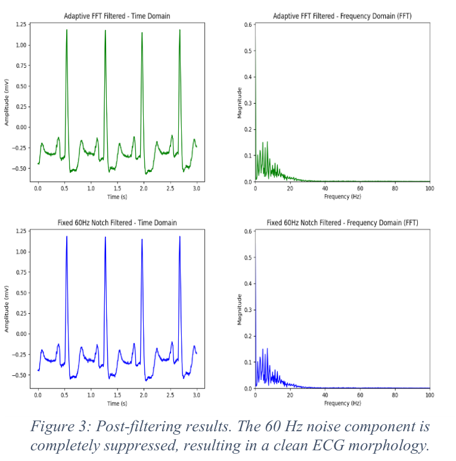

# ECG Notch Filtering and QRS Detection

A Python DSP study of power-line interference in ECG recordings from the MIT-BIH Arrhythmia Database. The project compares fixed and adaptive notch filters, then evaluates their output with Pan-Tompkins QRS detection. The accompanying paper is by Mohammad Bazzar and Bashar Ghosheh.

## Problem

Power-line interference near 60 Hz can add noise to ECG signals and affect downstream analysis. This project evaluates whether an FFT-based adaptive notch filter improves on a fixed 60 Hz IIR notch filter for MIT-BIH Record 105 (first channel, 360 Hz sampling rate).

## Method

1. Load Record 105 and its expert beat annotations using WFDB.
2. Apply a zero-phase IIR notch filter centered at 60 Hz (Q=30).
3. Find the dominant frequency in the 55-65 Hz band with an FFT, then apply a second notch filter centered on that detected frequency.
4. Run Pan-Tompkins processing on each filtered signal: 5-12 Hz bandpass, differentiation, squaring, and 150 ms moving-window integration.
5. Compare residual 60 Hz magnitude, SNR, QRS accuracy, missed beats, and false detections against the database annotations.

## Results reported in the paper

| Metric | Fixed 60 Hz notch | Adaptive FFT notch |
| --- | ---: | ---: |
| Detected interference frequency | 60.00 Hz (target) | 60.01 Hz |
| Residual noise magnitude | 1.97 | 1.96 |
| SNR | 36.42 dB | 36.42 dB |
| QRS detection accuracy | 93.40% | 93.40% |
| Missed beats (FN) | 128 | 128 |
| False detections (FP) | 53 | 53 |

The paper reports 2,616 detected beats. On this record, both notch filters produced essentially the same QRS metrics; the adaptive filter tracked a 60.01 Hz peak.

### Post-filtering comparison



This is Figure 3 from [Paper.pdf](Paper.pdf). The figure shows the filtered time-domain ECG and frequency-domain spectra for both methods.

## Run

Python 3.10 or newer and an internet connection are needed to fetch MIT-BIH data through WFDB. From the repository root:

### Windows PowerShell

```powershell
py -3 -m venv .venv
.\.venv\Scripts\Activate.ps1
python -m pip install -r requirements.txt
python main.py
```

### macOS or Linux

```bash
python3 -m venv .venv
source .venv/bin/activate
python -m pip install -r requirements.txt
python main.py
```

The script prints comparison metrics and opens time/frequency plots and the Pan-Tompkins processing-stage plots.

## Files

- `main.py` - dataset loading, filters, QRS detection, metrics, and plots.
- `requirements.txt` - Python dependencies.
- `Paper.pdf` - project report and source for the reported results and Figure 3.
- `results/post-filtering-comparison.png` - extracted Figure 3 image used above.

